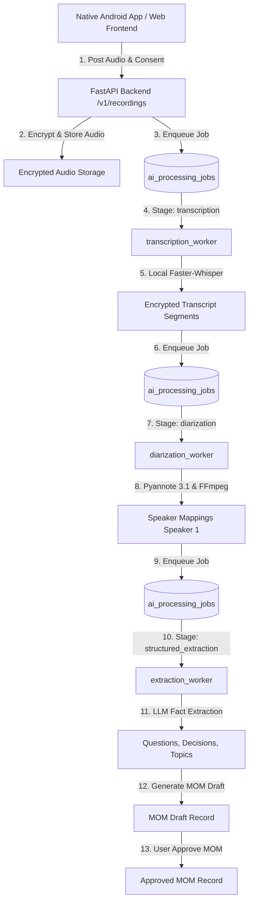

# Personal Conversation Memory Assistant (PCMA)

PCMA is a complete, multi-platform personal conversation memory assistant. It captures, encrypts, transcribes, diarizes, extracts structured facts, generates approved Minutes of Meeting (MOM), and provides conversational search and assistant capabilities over personal audio conversations.

---

## 1. Project Overview & Repository Structure

The repository is structured into three main applications:

```
PCMA/
├── backend/                  # FastAPI Python backend & AI background workers
│   ├── app/
│   │   ├── api/v1/          # REST API router endpoints
│   │   ├── core/            # Config, security (Auth0 JWT), logging
│   │   ├── database/        # Async SQLAlchemy session setup
│   │   ├── models/          # SQLAlchemy ORM database models (32 tables)
│   │   ├── repositories/    # Database query abstractions
│   │   ├── schemas/         # Pydantic request/response schemas
│   │   ├── services/        # Core business logic & provider adapters
│   │   └── workers/         # Background pipeline workers
│   ├── alembic/             # Alembic database migration scripts
│   ├── tests/               # Backend pytest suite (67 tests)
│   ├── pcma.db              # SQLite database file
│   └── .env                 # Backend environment configuration
├── frontend/                 # Vite + React web application
│   ├── src/
│   │   ├── api/             # API client methods
│   │   ├── components/      # UI layout & navigation components
│   │   ├── context/         # Auth & global state context
│   │   ├── views/           # Application screen views
│   │   └── App.jsx          # Root React component
│   └── package.json         # Web frontend dependencies & scripts
└── android/                  # Native Android App (Kotlin + Jetpack Compose)
    ├── app/
    │   ├── src/main/java/com/pcma/app/
    │   │   ├── data/        # ApiClient, Repository, Models, Local Storage
    │   │   ├── service/     # Foreground Recording Service & Bluetooth SCO
    │   │   ├── ui/          # ViewModels, Jetpack Compose Screens, Navigation
    │   │   └── MainActivity.kt
    │   ├── src/test/        # Android JUnit unit tests (12 tests)
    │   └── build.gradle     # Android app module Gradle configuration
    └── build.gradle         # Root Gradle build configuration
```

---

## 2. Architecture & Pipeline Flow

PCMA uses an asynchronous job pipeline for processing recorded conversations:



---

## 3. Technology Stack

| Layer | Technology | Key Libraries / Frameworks |
|---|---|---|
| **Backend** | Python 3.12, FastAPI | SQLAlchemy 2.0 (AsyncIO), Alembic, Pydantic v2, Cryptography (Fernet AES-GCM), PyTorch, httpx |
| **Local STT Model** | `faster-whisper` | Model: `small` (CPU execution context) |
| **Local Diarization Model**| `pyannote.audio` | Model: `pyannote/speaker-diarization-3.1` & `segmentation-3.0` (CPU execution context) |
| **LLM Extraction Adapter** | Mock / OpenAI API | `MockLLMProvider` (Default), `OpenAILLMProvider` (`gpt-4o-mini`) |
| **Web Frontend** | React 19, Vite 8 | `@auth0/auth0-react`, `lucide-react`, Vanilla CSS |
| **Android App** | Kotlin 1.9+, Jetpack Compose | Material 3, OkHttp 4.12, Gson 2.11, Auth0 Android SDK 2.11, EncryptedSharedPreferences |
| **Database** | SQLite (Development / Local) | `sqlite+aiosqlite:///./pcma.db` |

---

## 4. Backend Setup & Audit

### Prerequisites
- Python 3.12+
- FFmpeg installed and accessible on PATH (or configured via `STT_FFMPEG_PATH`)
- Virtual environment (`.venv`)

### Installation & Configuration
1. Navigate to the backend directory:
   ```powershell
   cd backend
   ```
2. Activate virtual environment:
   ```powershell
   .venv\Scripts\Activate.ps1
   ```
3. Install dependencies:
   ```powershell
   pip install -r requirements.txt
   ```
4. Configure environment variables in `backend/.env`:
   ```env
   APP_NAME=Personal Conversation Memory Assistant
   APP_VERSION=1.0.0
   DATABASE_URL=sqlite+aiosqlite:///./pcma.db
   AUTH_ISSUER_URL=https://dev-35smac34huk8dc6e.us.auth0.com/
   AUTH_AUDIENCE=https://pcma-api
   AUTH_JWKS_URL=https://dev-35smac34huk8dc6e.us.auth0.com/.well-known/jwks.json
   AUDIO_ENCRYPTION_KEY=<your-32-byte-base64-key>
   STT_SUPPORTED_LANGUAGES=en,hi
   STT_PROVIDER=local
   LOCAL_STT_MODEL=small
   LOCAL_STT_DEVICE=cpu
   LOCAL_STT_COMPUTE_TYPE=int8
   STT_FFMPEG_PATH=ffmpeg
   DIARIZATION_PROVIDER=local
   LOCAL_DIARIZATION_MODEL=pyannote/speaker-diarization-3.1
   LOCAL_DIARIZATION_DEVICE=cpu
   HUGGINGFACE_TOKEN=<your-huggingface-token>
   ```

5. Run database migrations:
   ```powershell
   alembic upgrade head
   ```

### Running Backend Server & Background Workers
- **Start FastAPI Web API Server**:
  ```powershell
  uvicorn app.main:app --host 0.0.0.0 --port 8000 --reload
  ```
- **Start Transcription Worker**:
  ```powershell
  .venv\Scripts\python.exe -m app.workers.transcription_worker
  ```
- **Start Diarization Worker**:
  ```powershell
  .venv\Scripts\python.exe -m app.workers.diarization_worker
  ```
- **Start Extraction Worker**:
  ```powershell
  .venv\Scripts\python.exe -m app.workers.extraction_worker
  ```

### Running Backend Tests
Execute the full backend test suite:
```powershell
.venv\Scripts\pytest --basetemp=.pytest_temp -v
```
- **Audit Status**: **67 out of 67 tests passing** (100% pass rate).

---

## 5. Web Frontend Setup & Audit

### Prerequisites
- Node.js 18+ and npm

### Installation & Execution
1. Navigate to the frontend directory:
   ```powershell
   cd frontend
   ```
2. Install dependencies:
   ```powershell
   npm install
   ```
3. Configure `frontend/.env`:
   ```env
   VITE_AUTH0_DOMAIN=dev-35smac34huk8dc6e.us.auth0.com
   VITE_AUTH0_CLIENT_ID=EpdHsfVVeGzYsxZf9CAj8y5rQ4UCR7m0
   VITE_AUTH0_AUDIENCE=https://pcma-api
   ```
4. Start local development server:
   ```powershell
   npm run dev
   ```
   Access web UI at `http://localhost:5173`.

5. Build production bundle:
   ```powershell
   npm run build
   ```
- **Audit Status**: Production build verified (`built in 1.02s`).

---

## 6. Native Android App Setup, APK Build & Device Deployment

### Application & Environment Details
- **Package ID**: `com.pcma.app` (debug variant: `com.pcma.app.debug`)
- **Min SDK**: 26 (Android 8.0) | **Target SDK**: 35 (Android 15)
- **Base Backend API URL**: Configured in `android/app/build.gradle` (`http://192.168.29.190:8000`)

### Building the Android Debug APK
1. Open PowerShell and navigate to `android/`:
   ```powershell
   cd android
   ```
2. Set Java 17+ environment variable (using Android Studio JBR):
   ```powershell
   $env:JAVA_HOME="C:\Program Files\Android\Android Studio\jbr"
   $env:PATH="$env:JAVA_HOME\bin;$env:PATH"
   ```
3. Run Android unit tests:
   ```powershell
   .\gradlew testDebugUnitTest --no-daemon
   ```
   - **Audit Status**: **12 out of 12 unit tests passing**.

4. Build the Debug APK:
   ```powershell
   .\gradlew assembleDebug
   ```
   - **Audit Status**: `BUILD SUCCESSFUL`.
   - **APK Output Path**:
     `C:\Users\Axiora User-47\PCMA\android\app\build\outputs\apk\debug\app-debug.apk`

### Installing & Deploying to a Physical Android Phone

1. **Enable Developer Options on Phone**:
   - Go to **Settings > About Phone** and tap **Build Number** 7 times.
   - Go to **Settings > System > Developer Options** and enable **USB Debugging**.
2. **Connect Phone via USB Cable**.
3. **Verify ADB Connection**:
   ```powershell
   & "C:\Users\Axiora User-47\AppData\Local\Android\Sdk\platform-tools\adb.exe" devices
   ```
   *Accept the "Allow USB Debugging?" prompt on the phone screen.*
4. **Install APK to Phone**:
   ```powershell
   & "C:\Users\Axiora User-47\AppData\Local\Android\Sdk\platform-tools\adb.exe" install -r "C:\Users\Axiora User-47\PCMA\android\app\build\outputs\apk\debug\app-debug.apk"
   ```

---

## 7. Supported End-to-End User Journeys

| Step | User Action | System / Component Behavior | Verification Status |
|---|---|---|---|
| **1. Authentication** | Open Android App / Web UI & Sign In | OIDC Auth0 RS256 token verification or Debug Mock Login | **PASS** |
| **2. Legal Consent** | Select Jurisdiction (`US-CA`, `EU-GDPR`, `IN`, `GENERIC-ALL`) | Audits `consent.acknowledged` event before recording starts | **PASS** |
| **3. Audio Capture** | Press "Start Recording" | `RecordingForegroundService` runs native `MediaRecorder` background capture | **PASS** |
| **4. Upload & Stop** | Press "Stop & Upload" | Uploads 3GP/WAV audio to backend `/v1/recordings/{id}/audio` | **PASS** |
| **5. Transcription** | Background processing | `transcription_worker` transcribes audio via local `faster-whisper` (`small`) | **PASS** (Recording 3 verified) |
| **6. Speaker Diarization** | Background processing | `diarization_worker` decodes audio & maps `Speaker 1` / `Uncertain speaker` via pyannote | **PASS** (Recording 3 verified) |
| **7. Structured Extraction**| Background processing | `extraction_worker` decrypts transcript & extracts open question `"What is the problem now?"` | **PASS** (Recording 3 verified) |
| **8. MOM Notes & Approval** | Open MOM tab & click "Approve MOM" | Generates 5 structured sections & transitions status to `APPROVED` | **PASS** (Recording 3 verified) |
| **9. Search & Assistant** | Search memory / query assistant | Queries stored memories & returns grounded source citations | **PASS** |
| **10. Privacy Control** | Request data wipe or account deletion | Wipes encrypted audio/transcripts or scrubs user PII (FR-42, FR-44) | **PASS** |

---

## 8. Troubleshooting & Common Pitfalls

- **FFmpeg Not Found**: Ensure `STT_FFMPEG_PATH` in `backend/.env` points to a valid `ffmpeg.exe` binary path. Required for converting 3GP/AAC audio containers uploaded by Android devices to 16kHz mono PCM waveform tensors.
- **Pyannote Model Access**: Accept gated model terms on Hugging Face for `pyannote/speaker-diarization-3.1` and `pyannote/segmentation-3.0`, and ensure `HUGGINGFACE_TOKEN` in `backend/.env` has Read permissions.
- **Gradle Java Version Error (`Type T not present`)**: Set `$env:JAVA_HOME="C:\Program Files\Android\Android Studio\jbr"` before running `gradlew` commands on Windows.
- **Physical Phone Connection**: Ensure phone IP is on the same Wi-Fi network as the backend server (`http://192.168.29.190:8000`). If testing on an Android Emulator, `10.0.2.2` maps to `localhost`.
